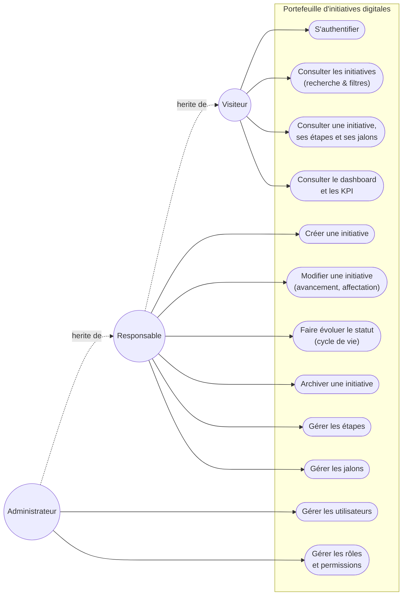
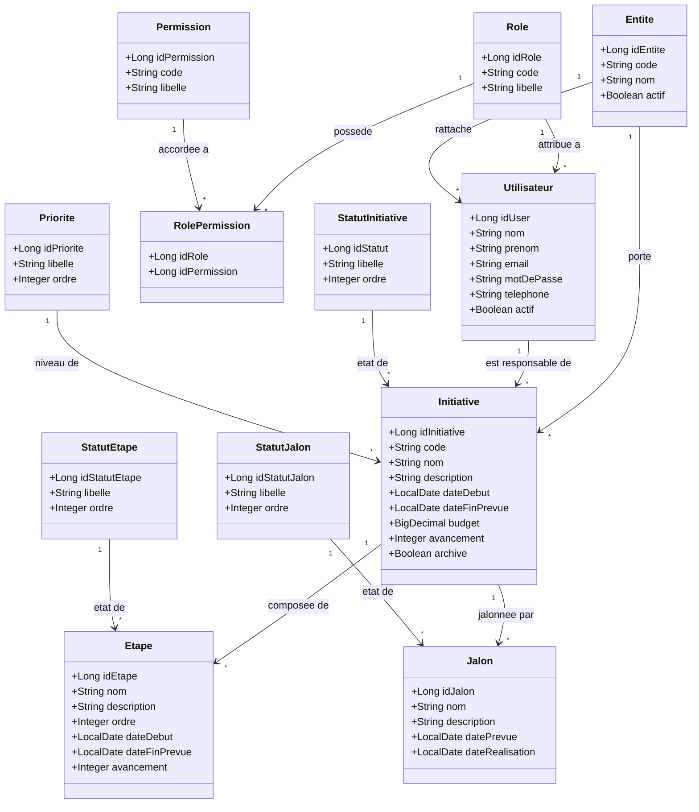
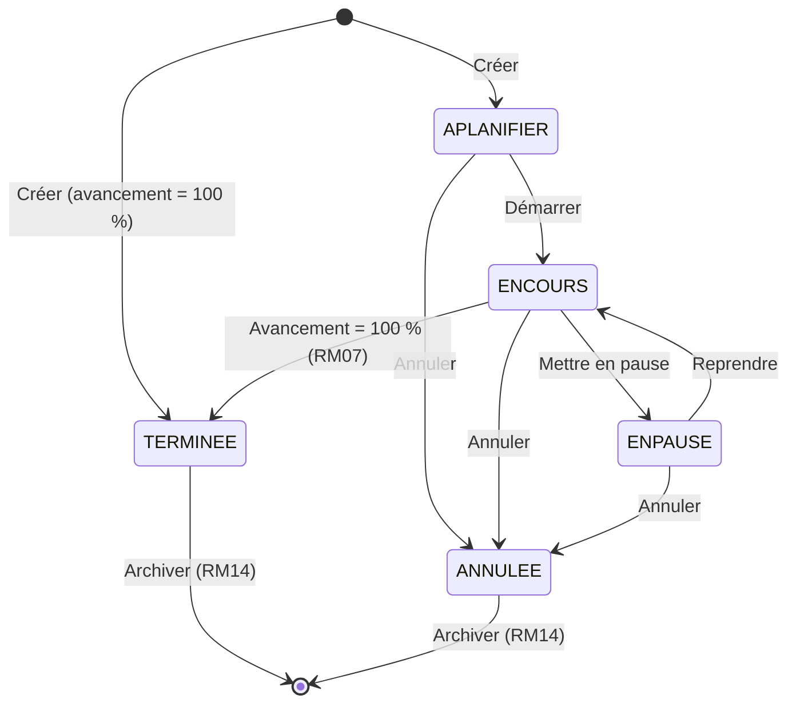
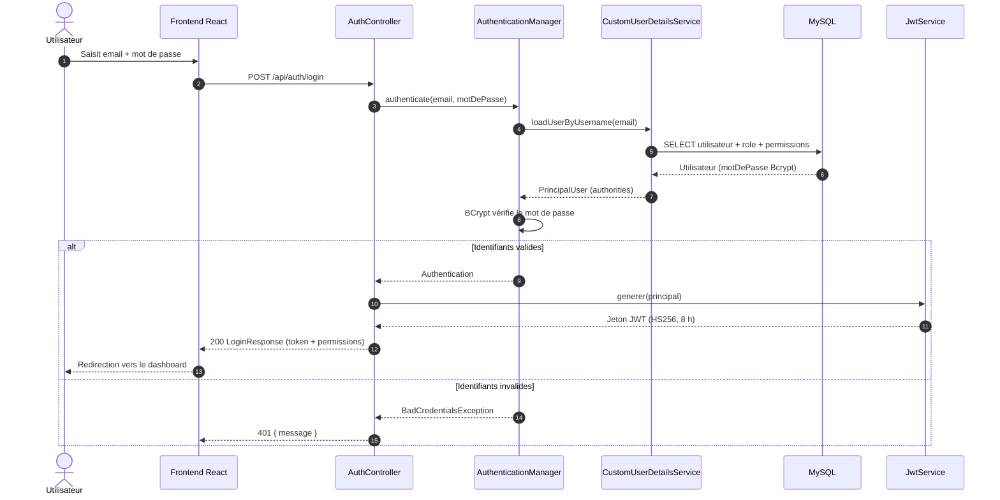
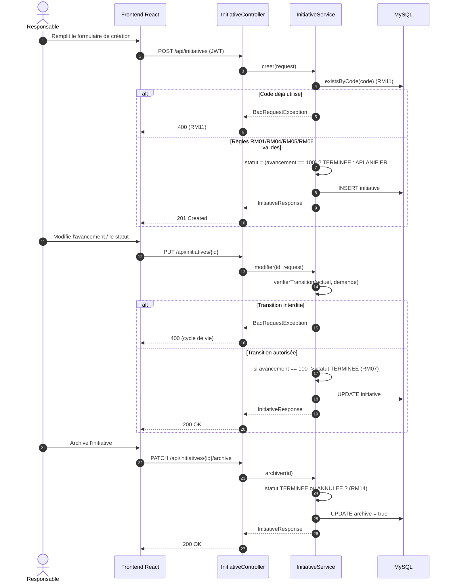
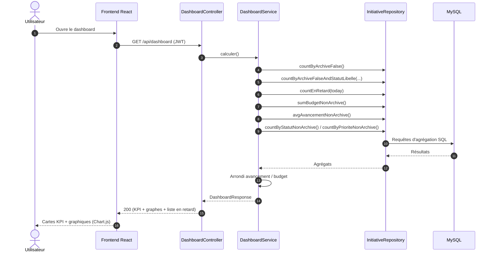
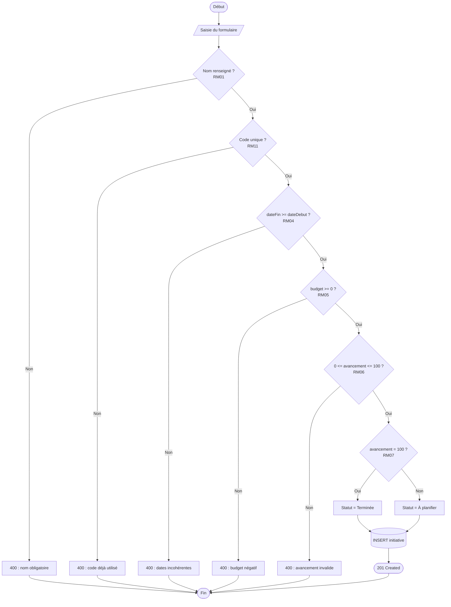
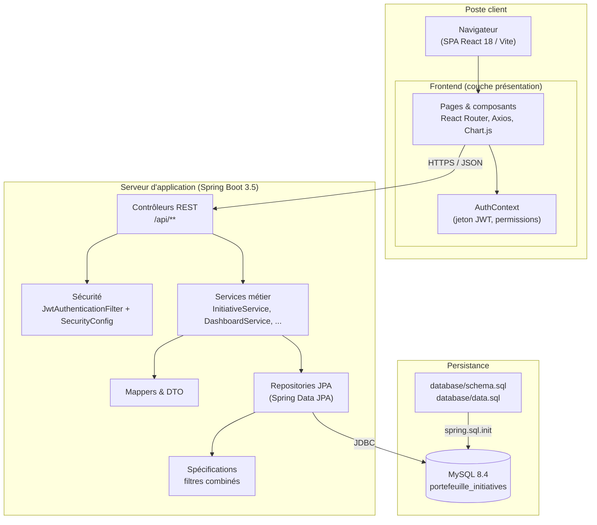
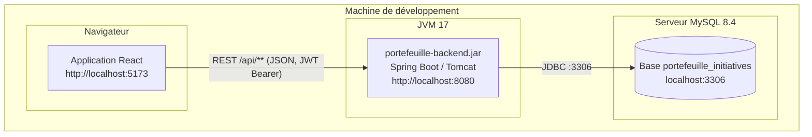
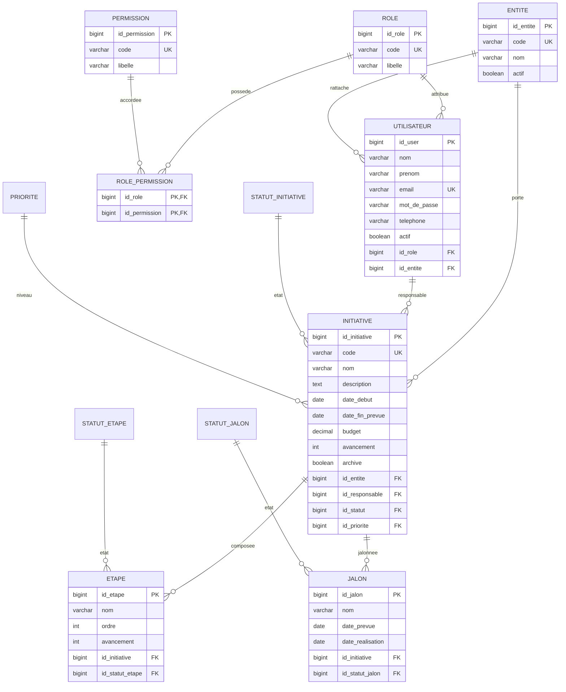

# Portefeuille d'initiatives digitales — IT6 Consulting

## Diagrammes UML corrigés (version Mermaid)

> **Source de vérité.** Ces diagrammes sont reconstruits à partir du **code réel**
> (entités JPA, services, contrôleurs, `SecurityConfig`, `schema.sql`) et non des
> croquis initiaux. Ils reflètent donc exactement l'application livrée.
>
> Chaque diagramme est fourni en **Mermaid** (ci-dessous, rendu par GitHub/IDE) et
> en **PlantUML** (dossier `docs/UML/plantuml/`).

---

## 1. Diagramme de cas d'utilisation

Trois acteurs selon le cahier des charges. Les profils sont **hiérarchiques** :
les droits du Visiteur sont inclus dans ceux du Responsable, eux-mêmes inclus
dans ceux de l'Administrateur.

---

## 2. Diagramme de classes (domaine)

---

## 3. Diagramme d'états — cycle de vie d'une initiative

Règles reflétées : création « À planifier » (ou directement « Terminée » si
avancement = 100 %, RM07), transitions autorisées uniquement, archivage réservé
aux statuts terminaux (RM14).

---

## 4. Diagramme de séquence — authentification JWT

---

## 5. Diagramme de séquence — création puis évolution d'une initiative

---

## 6. Diagramme de séquence — calcul des KPI du dashboard

Les KPI sont **calculés par l'API** (aucune donnée codée en dur).

---

## 7. Diagramme d'activité — création d'une initiative (règles métier)

---

## 8. Diagramme de composants — architecture logique

---

## 9. Diagramme de déploiement

---

## 10. Modèle physique de données (ER)

---

## Références croisées

| Diagramme | Éléments du code source |
|---|---|
| Cas d'utilisation | `SecurityConfig`, permissions (données de référence) |
| Classes | `entity/*.java`, `Schema.sql` |
| États | `InitiativeService` (`verifierTransition`, RM07, RM14) |
| Séquence authentification | `AuthController`, `JwtService`, `CustomUserDetailsService` |
| Séquence création/cycle de vie | `InitiativeController`, `InitiativeService` |
| Séquence KPI | `DashboardController`, `DashboardService`, `InitiativeRepository` |
| Activité | `InitiativeRequest` (validations), `InitiativeService.validerReglesMetier` |
| Composants | `pom.xml`, `SecurityConfig`, `SpringDataJpa`, `styles.css` |
| Déploiement | `application.yml` (port 8080, datasource), `start-mysql.ps1` |
| ER | `database/schema.sql` |
